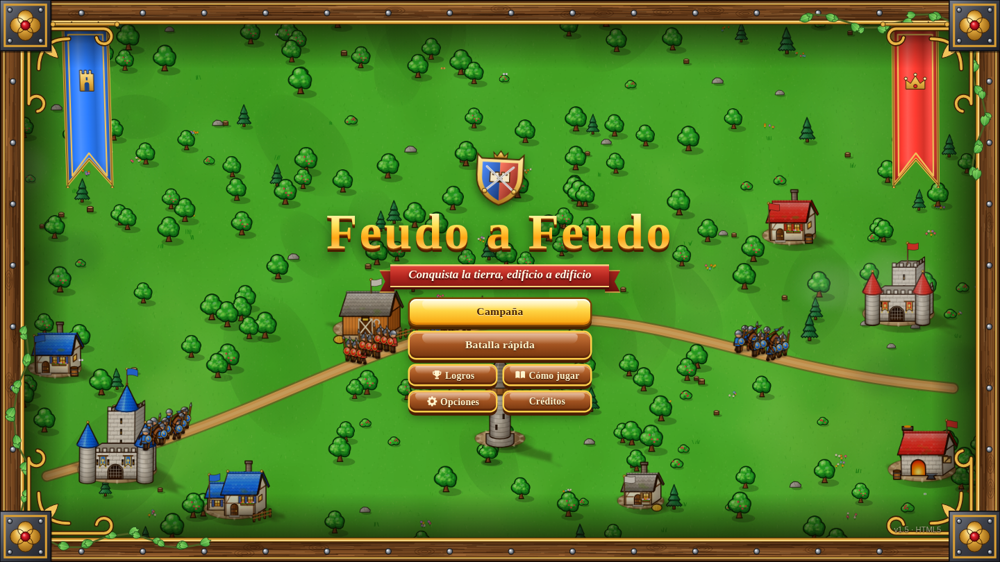
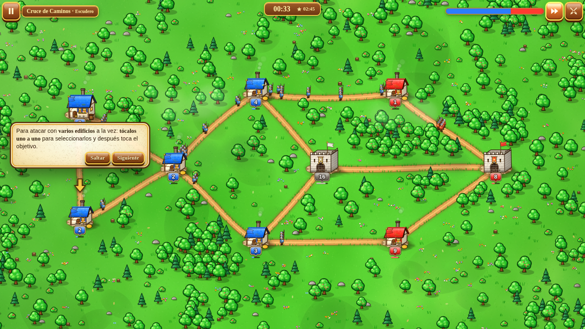
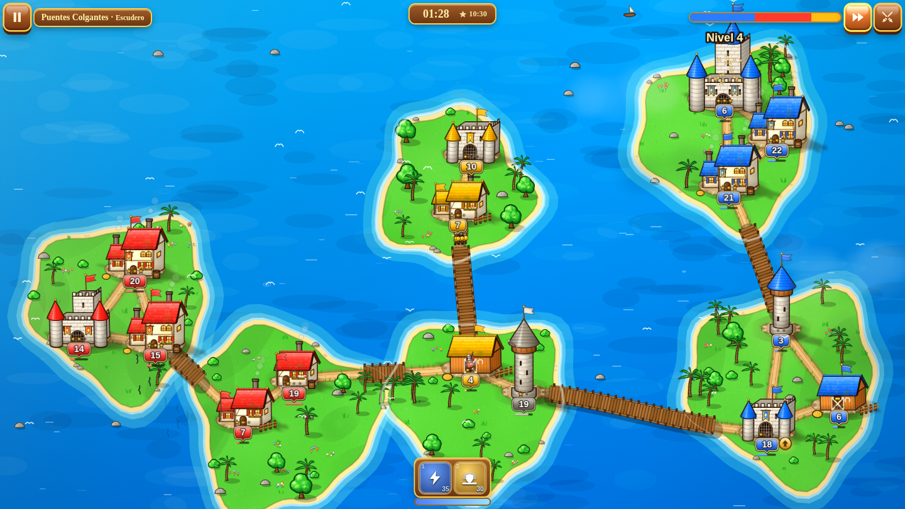
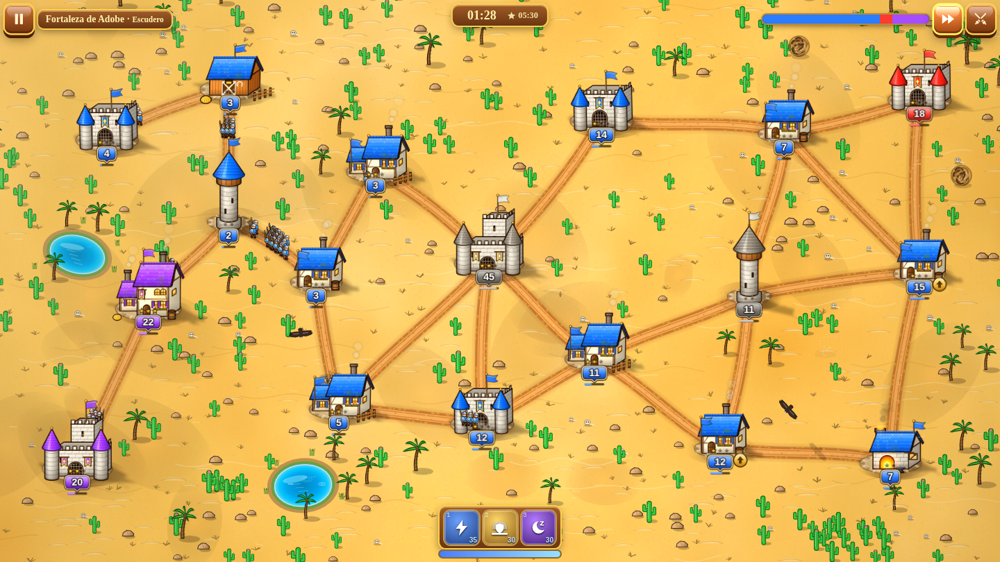
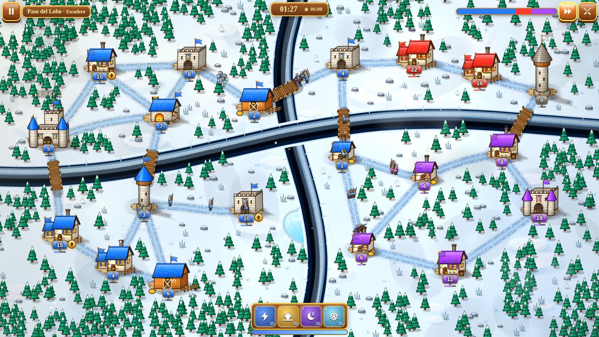
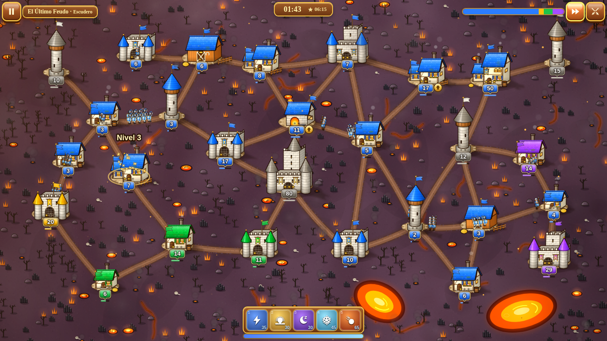
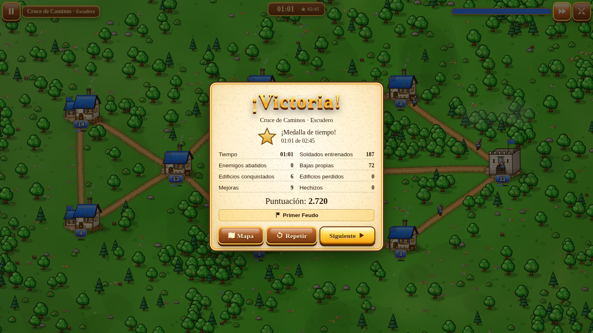

# Feudo a Feudo

**Conquista la tierra, edificio a edificio.**

*Idea original de **Fraudy Martinez**.*

Juego de estrategia medieval en tiempo real hecho íntegramente en HTML5 (HTML + CSS + JavaScript, sin librerías). Los gráficos y buena parte de los sonidos se generan con código; la música son 13 pistas de repositorios libres y los sonidos de batalla, grabaciones libres. Funciona sin conexión y existe en tres formas: navegador, app de Windows y app de Android.

<p align="center">
  
</p>

<p align="center">
  <a href="https://yottomtnz.github.io/feudo-a-feudo/juego/"><b>▶ JUGAR AHORA EN EL NAVEGADOR</b></a>
  &nbsp;·&nbsp;
  <a href="https://github.com/YottoMtnz/feudo-a-feudo/releases/download/v1.5-windows/Feudo.a.Feudo.exe"><b>⬇ Windows</b></a>
  &nbsp;·&nbsp;
  <a href="https://github.com/YottoMtnz/feudo-a-feudo/releases/download/v1.5-android/FeudoAFeudo.apk"><b>⬇ Android</b></a>
</p>

## Capturas

| | |
|---|---|
|  |  |
|  |  |
|  |  |


## Cómo jugar

| Dónde | Qué abrir |
|---|---|
| **Windows** | `Feudo a Feudo.exe` (un solo archivo con todo dentro; ver «App de Windows») |
| **Android** | instala `FeudoAFeudo.apk` (ver «App de Android») |
| **Navegador** | `juego/index.html` con Chrome, Edge, Firefox o Safari |
| **Un solo archivo** | `juego/jugar-sin-instalar.html`: el juego entero en un HTML. Con la carpeta `music/` al lado suena la música real; sin ella, la del propio juego |
| **Internet** | **ya está en línea:** <https://yottomtnz.github.io/feudo-a-feudo/> (botón «Jugar en web»). La carpeta `juego/` se puede subir tal cual a cualquier alojamiento estático (GitHub Pages, Netlify, Vercel, un servidor propio…) |

El progreso, los logros y las opciones se guardan solos.

## Reglas

- Cada edificio con dueño entrena soldados hasta llenar su capacidad. Si recibe refuerzos por encima de su capacidad, el exceso se pierde poco a poco.
- Al enviar tropas sale **la mitad** de la guarnición. Si llegan más atacantes que defensores, el edificio cambia de dueño.
- Las tropas marchan por los caminos y sólo atraviesan edificios propios: un edificio enemigo en medio bloquea el paso.
- Dos ejércitos rivales que se cruzan en un camino luchan cuerpo a cuerpo.
- **Mejorar** un edificio cuesta la mitad de su capacidad en soldados y le da una estrella: más capacidad y más producción.
- Un edificio **conquistado pierde todas sus estrellas** y vuelve al nivel básico, lo tomes tú o te lo quiten.
- Las **atalayas** lanzan venablos a toda tropa enemiga cercana; con tres estrellas sus lanzas encantadas atraviesan a dos soldados por disparo.
- Ganas cuando ningún rival tiene edificios ni tropas en marcha.

## Dificultad

La IA de los señores rivales sigue el ritmo de los clásicos del género: se expanden, atacan por oleadas y defienden lo suyo, pero tardan unos segundos en enterarse de lo que pasa en el mapa y no se lanzan todos a la vez contra ti.

- **Escudero:** tregua de unos 40 s, ataques espaciados, errores de cálculo y respiro cuando vas muy por detrás.
- **Caballero:** rivales más despiertos, que castigan los descuidos sin ensañarse.
- **Señor de la Guerra:** rivales rápidos y coordinados, sin magia para nadie.

Cada nivel se ha comprobado con partidas simuladas. Un jugador de ritmo humano gana al menos el 80 % de las veces en Escudero y el 40 % en Caballero. Un jugador experto gana al menos el 40 % en Señor de la Guerra. El informe está en `tools/levels-report.txt`.

## Música

13 pistas MP3 elegidas por Fraudy Martinez en repositorios libres (CC0 y CC BY): una para el menú, otra para el mapa, una o dos por mundo, una para la batalla final de cada mundo y melodías de victoria y derrota. La lista completa, con autores, licencias y enlaces, está en `music/LEEME.txt` y en la pantalla de Créditos.

- **Volumen igualado:** todas suenan igual de fuertes (−19 LUFS con la música al 100 %). El control de música sigue una curva natural: al 50 % la música queda un poco por debajo de los efectos de batalla.
- **Variedad:** en los mundos con dos pistas, cada nivel empieza por una distinta y, al acabar una, suena la otra.
- **Cambiar una pista:** pon el MP3 nuevo en `music/` con el mismo nombre y ejecuta `python3 tools/music-gains.py` para igualar su volumen. Si falta un archivo, ese hueco usa la música generada por el juego.

## Sonidos de batalla

Gritos de guerra al salir tus tropas (y el de todo un ejército en los ataques grandes), espadas y golpes en cada choque, gritos durante la lucha, soldados que caen, tambores al empezar cada batalla y el cuerno antes de la batalla final de cada mundo. Son 34 grabaciones libres (Mixkit, StarNinjas y Universfield), elegidas por Fraudy Martinez, con su volumen igualado y colocadas a izquierda o derecha según dónde ocurra la pelea. Detalle en `sfx/LEEME.txt`.

## Escenarios con vida

Cada mundo se mueve: árboles, palmeras y juncos se mecen con el viento, los ríos corren y la lava fluye, y pasan nubes con su sombra.

- **Valle:** patos en los lagos, peces que saltan, mariposas y bandadas de pájaros.
- **Islas:** espuma que respira en las orillas, barcas que se mecen y peces en el mar.
- **Desierto:** bolas de heno que ruedan, remolinos de arena y buitres en círculo.
- **Hielo:** destellos en el hielo y bandadas.
- **Volcán:** charcos y lagos de lava con burbujas que revientan, y nubes de ceniza.

Edificios y árboles proyectan su sombra (el sol viene de arriba a la izquierda); los tejados tienen tejas de tono desigual y algo de musgo, las casas contraventanas y jardineras, los caminos rodadas de carro, los lagos profundidad y orilla, y las grietas y cañones pared y fondo.

En pantallas más alargadas (o más altas) que el mapa, como la mayoría de móviles, la batalla y el mapa de campaña ocupan toda la pantalla: se ve más terreno a los lados en vez de bandas, sin deformar nada.

Los edificios con dueño respiran y se balancean suavemente; los neutrales, grises y vacíos, se quedan quietos. La pantalla de inicio tiene un marco medieval con estandartes de los dos reinos.

Todo esto se limita según la calidad gráfica: en «Media» hay menos y en «Baja» nada (el escenario queda quieto). Las plantas se mecen redibujando el terreno por trozos unas 10 veces por segundo, así su coste no depende de cuántas haya.

## Opciones

- **Sonido:** volumen de música y de efectos.
- **Gráficos:** calidad, escala de render (50–150 %), límite de FPS (30, 60, 120, 144 o sin límite) y contador de FPS. En Android el límite empieza en 60 FPS.
- **Pantalla:** en la app de Windows, modo (pantalla completa, ventana o ventana maximizada), resolución y frecuencia de pantalla completa, tamaño de ventana y sincronización vertical. En el navegador, un botón de pantalla completa.
- **Ayudas:** rutas previstas, consejos del tutorial y borrar el progreso.

## Rendimiento

El juego está pensado para ir fluido también en móviles sin calentarlos:

- La resolución del lienzo tiene un tope según la calidad y el dispositivo (en el móvil, 1,75× en Alta y 1,25× en Media).
- Las placas de tropas, las banderas, los resplandores y las partículas se dibujan desde imágenes ya preparadas, no se recalculan en cada fotograma.
- Las imágenes de cada nivel se preparan poco a poco al empezar, para que no haya tirones en mitad de una batalla.
- En pausa casi no se dibuja, y en Android se limita a 60 FPS (pantallas de 90-120 Hz).
- Si la tarjeta gráfica pierde sus imágenes (reinicio del controlador, cambio de gráfica en portátiles…), el juego las vuelve a dibujar solo: ya no se queda la pantalla en negro con sólo los marcadores.
- En Windows, la ventana del juego pide la gráfica de alto rendimiento en los portátiles con dos gráficas.

Si aun así va justo: Opciones → Gráficos → Calidad Media o Escala de render 75 %.

## App de Windows

`Feudo a Feudo.exe` lleva dentro el juego, la música y el icono: no se instala nada. Usa como motor Microsoft Edge, que viene con Windows 10 y 11, sin barras de navegador: en pantalla completa, en modo quiosco (no aparece ninguna barra ni botón, tampoco al llevar el ratón arriba); en ventana, en una ventana propia (si no está Edge, usa Google Chrome; si tampoco, el navegador predeterminado).

- **Opciones → Pantalla:** al pulsar «Aplicar», la ventana se reabre con los cambios y la partida se conserva. La resolución elegida sólo se usa mientras juegas: al salir, la pantalla vuelve a la del escritorio.
- **Pantalla completa:** se comporta como la pantalla completa exclusiva de los juegos de PC. Si cambias de programa (`Alt+Tab`, tecla Windows), el juego se minimiza y se pausa, y la pantalla vuelve a la resolución del escritorio; al volver, recupera la del juego. `Alt+Enter` cambia entre pantalla completa y ventana (desde la ventana, también `F11`); en plena batalla pregunta antes, porque al reabrirse la ventana esa batalla se pierde.
- **Salir:** botón «Salir» del menú principal o del menú de pausa, cerrar la ventana o `Alt+F4`.
- **La primera vez**, Windows puede mostrar «Windows protegió su PC» porque el ejecutable no lleva firma de empresa: «Más información» → «Ejecutar de todas formas».
- **Datos:** partida y ajustes en `%APPDATA%\FeudoAFeudo`; perfil del motor en `%LOCALAPPDATA%\FeudoAFeudo\Motor`. Para desinstalar, borra el `.exe` y esas dos carpetas.

## App de Android

`FeudoAFeudo.apk` funciona en Android 5.0 o posterior, en horizontal y a pantalla completa (también junto a la cámara frontal en los móviles con muesca o agujero), con la música dentro. No pide ningún permiso.

- **Instalar:** pasa el APK al móvil y ábrelo. Android pedirá permitir «instalar apps desconocidas» a la aplicación desde la que lo abres (Archivos, Chrome, WhatsApp…). Si Play Protect avisa de que no conoce la app, elige instalar de todas formas.
- **Botón Atrás:** cierra la ventana abierta, pausa la partida, vuelve al menú y, en el menú, pregunta si salir.
- **Actualizar:** un APK nuevo se instala encima, conservando el progreso, si está firmado con la misma clave (`tools/android/feudo.keystore`, contraseña `feudoafeudo`) y tiene un número de versión mayor. Guarda esa clave.

## Contenido

- **45 niveles** en **5 mundos**: Valle de Robledal, Archipiélago de Sal, Dunas de Ámbar, Cumbres de Escarcha y Caldera de Brasas.
- **3 modos por nivel:** Escudero, Caballero y Señor de la Guerra (sin magia). Cada modo se desbloquea al superar el anterior.
- **Medalla de tiempo** en cada nivel y modo (135 en total) y puntuación.
- **5 edificios:** Aldea, Castillo, Atalaya, Establo y Herrería, con 3 o 4 niveles de mejora.
- **3 tropas:** soldados, jinetes (salen del Establo: doble de velocidad, esquivan flechas) y caballeros (salen de la Herrería: doble de fuerza y aguante).
- **5 reliquias mágicas:** Rayo, Égida, Sopor, Ventisca y Meteoro, con maná que se recarga.
- Hasta **3 señores rivales** a la vez, con personalidades distintas y una IA que se adapta al modo.
- **Tutorial** integrado, **27 logros**, estadísticas y **batalla rápida** con mapas generados al azar.

## Controles

| Acción | Ratón / teclado | Pantalla táctil |
|---|---|---|
| Seleccionar (o soltar) un edificio tuyo | Clic en él | Toque |
| Seleccionar varios | Clic en cada uno | Toque en cada uno |
| Atacar con los seleccionados (la mitad de cada uno) | Clic en el enemigo | Toque en el enemigo |
| Otra oleada | Vuelve a hacer clic en el enemigo | Vuelve a tocarlo |
| Reforzar uno de tus edificios | Doble clic en él | Doble toque |
| Soltar la selección | Clic en el suelo o `Esc` | Toque en el suelo |
| Seleccionar todos | `A` o botón ⚔ | Botón ⚔ |
| Atacar arrastrando | Arrastrar del edificio al objetivo | Igual |
| Ver ficha y alcance | Pasar el puntero | Mantener pulsado |
| Mejorar | Flecha dorada ▲, clic derecho o `U` | Flecha dorada ▲ |
| Hechizos | `1`–`5` y luego el objetivo | Botón y luego el objetivo |
| Velocidad doble | `F` | Botón ⏩ |
| Pausa | `Espacio` | Botón ⏸ (en Android, también Atrás) |

## Estructura del proyecto

```
juego/index.html           página principal del juego
juego/jugar-sin-instalar.html  todo el juego en un solo archivo
css/style.css              interfaz (madera, pergamino y oro)
js/core/                   motor sin dependencias del navegador
  util.js                  azar con semilla, ruido, color, matemáticas
  data.js                  facciones, edificios, tropas, hechizos, modos, mundos, logros
  map.js                   terreno, caminos curvos, puentes y búsqueda de rutas
  game.js                  simulación: producción, marchas, choques, atalayas, hechizos
  ai.js                    inteligencia de los señores rivales
  mapgen.js                generador de mapas (campaña y batalla rápida)
  levels.js                los 45 niveles de la campaña (generado)
  host.js                  plataforma: navegador, app de Windows o app de Android
  storage.js               progreso, ajustes y logros
js/render/                 arte procedural, terreno y renderizado
  life.js                  vida del escenario: plantas al viento, agua, lava, animales y nubes
js/audio/audio.js          efectos, música generativa y reproductor de pistas
js/audio/tracks.js         pistas de música: archivo, volumen, autor y licencia
js/audio/battle.js         sonidos grabados de batalla: cuándo y cómo suenan
js/audio/sfx-data.js       los sonidos de batalla dentro del juego (generado)
js/ui/                     pantallas, HUD, controles y tutorial
music/                     las 13 pistas MP3 (ver music/LEEME.txt)
sfx/                       los 34 sonidos de batalla en MP3 (ver sfx/LEEME.txt)
img/                       icono
desktop/                   lanzador de la app de Windows (Go)
tools/build-levels.js      genera y equilibra los niveles con simulaciones IA contra IA
tools/build-single.js      crea jugar-sin-instalar.html
tools/build-windows.sh     compila dist/Feudo a Feudo.exe
tools/windows/             icono, manifiesto y versión del .exe
tools/android/             compilador del APK: manifiesto, recursos, código y firma
tools/icon/                genera los iconos de todas las plataformas
tools/music-gains.py       iguala el volumen de las pistas
tools/build-sfx.py         prepara los sonidos de batalla y genera js/audio/sfx-data.js
dist/                      resultados de las compilaciones
```

## Para desarrolladores

```
node tools/build-levels.js                 # regenera los 45 niveles y sus tiempos de medalla (Node 18+)
node tools/build-single.js [--con-musica]  # archivo único; con --con-musica mete también los MP3 (≈ 90 MB)
tools/build-windows.sh                     # app de Windows (Go 1.21+ y Python 3)
python3 tools/android/build-apk.py         # app de Android (Python 3 con Pillow y cryptography, y Java)
python3 tools/music-gains.py               # iguala el volumen de la música (ffmpeg)
python3 tools/build-sfx.py                 # sonidos de batalla → js/audio/sfx-data.js (ffmpeg)
python3 tools/icon/make-icons.py           # iconos (Playwright con Chromium y Pillow)
```

La app de Android se compila sin el SDK de Android: `tools/android/` escribe el manifiesto y los recursos en su formato binario, ensambla el código de `MainActivity.smali` (un WebView a pantalla completa) y firma el APK (esquema v1, compatible con todas las versiones de Android para una app con `targetSdkVersion` 29).

Parámetros de prueba en la URL: `index.html?level=w3l5&mode=2` abre un nivel directamente; `&autoplay=1` deja que la IA juegue por ti; `?screen=map&world=2` abre el mapa de un mundo.

## Créditos

- **Idea original:** Fraudy Martinez.
- **Música:** RandomMind (CC0), Alexander Nakarada — creatorchords.com (CC BY 4.0), glitchart con remezcla de Tausdei y Hitctrl (CC BY 3.0), Bobjt y tridentkeep (CC BY 3.0). Detalle por pista en `music/LEEME.txt`.
- **Sonidos de batalla:** Mixkit, StarNinjas (CC0) y Universfield (Pixabay). Detalle en `sfx/LEEME.txt`.
- **Código, gráficos y el resto de efectos de sonido:** originales de *Feudo a Feudo*, generados por código. Inspirado en los clásicos de conquista casual en tiempo real.
